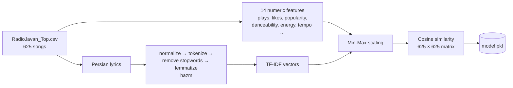

# 🎵 RadioJavan Music Recommender

[](https://github.com/parvvaresh/Music-recommender-system/actions/workflows/ci.yml)

A content-based recommender for **625 top RadioJavan songs**. Pick a song and it returns the 10 most similar tracks, using the song's audio features, popularity and its **Persian lyrics**.

You can use it in three ways:

- 🌐 **Web app**: a React UI with live search, backed by a FastAPI REST API
- 🔌 **REST API**: JSON endpoints with Swagger docs
- 💻 **CLI**: `python RJ_Recommendation_System.py "Gentleman"`

---

## Table of contents

- [How it works](#-how-it-works)
- [Quick start (Docker Compose)](#-quick-start-docker-compose)
- [Local development](#-local-development)
- [API reference](#-api-reference)
- [CLI](#-cli)
- [Testing](#-testing)
- [Performance testing (RPS, p50, p95)](#-performance-testing-rps-p50-p95)
- [CI/CD](#-cicd)
- [Retraining the model](#-retraining-the-model)
- [Project structure](#-project-structure)

---

## 🧠 How it works



1. **Features**: RadioJavan plays and likes, Spotify popularity, and audio features (danceability, energy, key, loudness, mode, speechiness, acousticness, instrumentalness, liveness, valence, tempo).
2. **Lyrics**: Persian text is normalized, tokenized, stripped of stopwords and lemmatized with [hazm](https://github.com/roshan-research/hazm), then turned into TF-IDF vectors.
3. Both parts are Min-Max scaled and concatenated. A **cosine-similarity matrix** between all songs is precomputed and saved as `model.pkl`.
4. At request time, recommending is just sorting one row of that matrix, so responses are fast.

> Songs are addressed by `id` (their row in the CSV), because some titles belong to more than one artist (for example "Darya" by Masih and by Ehaam).

---

## 🚀 Quick start (Docker Compose)

```bash
git clone https://github.com/parvvaresh/Music-recommender-system
cd Music-recommender-system
docker compose up -d --build
```

| Service | URL | Description |
| --- | --- | --- |
| Frontend | http://localhost:3000 | React app served by nginx. `/api` is proxied to the backend |
| Backend | http://localhost:8000/docs | FastAPI with Swagger UI |

Ports and workers can be changed with environment variables:

```bash
FRONTEND_PORT=3010 BACKEND_PORT=8010 WEB_CONCURRENCY=4 docker compose up -d --build
```

Stop it with `docker compose down`.

---

## 🛠 Local development

**Requirements:** Python 3.10+ and Node.js 20+.

```bash
# Backend
python -m venv .venv && source .venv/bin/activate
pip install -r requirements.txt
uvicorn api.main:app --reload            # http://localhost:8000

# Frontend (in another terminal)
cd frontend
npm install
npm run dev                              # http://localhost:5173
```

The Vite dev server proxies `/api` to `http://localhost:8000`. If your API runs somewhere else, set `API_PROXY_TARGET`:

```bash
API_PROXY_TARGET=http://localhost:8001 npm run dev
```

### Environment variables

| Variable | Default | Used by |
| --- | --- | --- |
| `RJ_CSV_PATH` | `api/models/data/RadioJavan_Top.csv` | API: song catalogue |
| `RJ_MODEL_PATH` | `api/models/fainal_model/model.pkl` | API: similarity matrix |
| `RJ_CORS_ORIGINS` | `http://localhost:5173` | API: comma-separated allowed origins |
| `WEB_CONCURRENCY` | `2` | Backend container: number of uvicorn workers |
| `API_PROXY_TARGET` | `http://localhost:8000` | Vite dev server: where `/api` is proxied |
| `VITE_API_URL` | *(same origin)* | Frontend build: API base URL |

---

## 📡 API reference

Interactive docs are available at `/docs` (Swagger) and `/redoc`.

| Method | Endpoint | Description |
| --- | --- | --- |
| GET | `/api/health` | Health check and number of songs |
| GET | `/api/songs?q=&limit=10` | Search by title or artist (title prefix matches rank first) |
| GET | `/api/songs/{id}` | One song |
| GET | `/api/songs/{id}/recommendations?k=10` | Top-`k` similar songs for a song id |
| GET | `/api/recommendations?title=&k=10` | Same, by title (exact, case-insensitive, or closest fuzzy match) |

`limit` and `k` must be between 1 and 50. Unknown songs return `404`.

**Example**

```bash
curl "http://localhost:8000/api/recommendations?title=gentleman&k=2"
```

```json
{
  "song": { "id": 0, "title": "Gentleman", "artist": "Sasy", "plays": 97011366, "likes": 92837, "popularity": 50, "published": "Mar 6 2019" },
  "recommendations": [
    { "id": 229, "title": "Nakoni Bavar", "artist": "Zedbazi", "plays": 20664029, "likes": 27273, "popularity": 38, "published": "Oct 8 2014", "score": 0.3178 },
    { "id": 62, "title": "Mr. Lodeh", "artist": "Amir Tataloo", "plays": 33945088, "likes": 36679, "popularity": 43, "published": "Apr 25 2015", "score": 0.2819 }
  ]
}
```

---

## 💻 CLI

```bash
python RJ_Recommendation_System.py "Gentleman"
```

```
 rank          musicName     artistName
    1       Nakoni Bavar        Zedbazi
    2          Mr. Lodeh   Amir Tataloo
    3 To Ke Nisti Pisham          Masih
    4             Moohat Mohsen Yeganeh
    5             Doctor           Sasy
    6      Harjaye Shahr     Ali Yasini
    7        Tekoon Bede          Arash
    8     Ashegham Kardi   Hoorosh Band
    9             Ey Vay          Sahar
   10          Ey Joonam     Sami Beigi
```

If the title isn't an exact match, the closest title is used. The CLI also runs in Docker:

```bash
docker build -t radiojavan-cli .
docker run --rm radiojavan-cli "Gentleman"
```

---

## ✅ Testing

```bash
pytest -v                     # CLI, API and load-test helper tests
cd frontend && npm test       # React tests (Vitest + Testing Library)
flake8 .                      # Lint
```

- **API tests** (`tests/test_api.py`) use a small fake catalogue, plus one check that the real CSV and model are aligned.
- **Frontend tests** (`frontend/src/App.test.jsx`) mock `fetch` and cover search, selecting a song, browsing recommendations, and error states.

---

## ⚡ Performance testing (RPS, p50, p95)

`perf/load_test.py` runs a fixed-duration load test with N concurrent workers. It sends a realistic mix of requests: 40% search, 40% recommend by id and 20% recommend by title. It reports **RPS** plus **p50 / p95 / p99** latency per endpoint and overall.

```bash
docker compose up -d --build
python -m perf.load_test --url http://localhost:3000 --duration 30 --concurrency 20
```

Example result (MacBook, through nginx, 2 uvicorn workers):

| Endpoint | Requests | RPS | p50 (ms) | p95 (ms) | p99 (ms) | Errors |
| --- | ---: | ---: | ---: | ---: | ---: | ---: |
| recommend_by_id | 1538 | 101.7 | 49.9 | 233.5 | 492.7 | 0 |
| recommend_by_title | 709 | 46.9 | 47.6 | 230.4 | 503.0 | 0 |
| search | 1525 | 100.8 | 52.0 | 237.4 | 412.9 | 0 |
| **overall** | 3772 | 249.4 | 50.4 | 234.4 | 488.1 | 0 |

Useful flags:

| Flag | Description |
| --- | --- |
| `--duration`, `--concurrency`, `--warmup` | Load shape (warm-up requests are not measured) |
| `--max-p95-ms`, `--max-error-rate`, `--min-rps` | Exit with code 1 if a threshold is missed |
| `--json-out FILE` | Save the full report as JSON |
| `--summary-out FILE` | Append a Markdown table (defaults to `$GITHUB_STEP_SUMMARY`) |

---

## 🔄 CI/CD

`.github/workflows/ci.yml` runs on every push and pull request to `main`:

| Job | What it does |
| --- | --- |
| `build-test-lint` | flake8 and pytest (CLI, API, load-test helpers) |
| `frontend` | `npm ci`, Vitest, production build |
| `performance` | Builds and starts the stack with `docker compose`, then runs a 30s load test through nginx. Fails if **p95 > 1000 ms** or **error rate > 1%**. The RPS/p50/p95/p99 table appears in the run's summary, and the JSON report is uploaded as an artifact |

---

## 🔁 Retraining the model

The training scripts live in `api/models/` and need [hazm](https://pypi.org/project/hazm/) for Persian text processing:

```bash
pip install hazm
cd api/models
python save_model.py      # writes fainal_model/model.pkl
```

Retrain whenever you change the CSV. The API checks on startup that the matrix size matches the number of songs.

---

## 📁 Project structure

```
.
├── api/
│   ├── main.py                  # FastAPI app and routes
│   ├── recommender.py           # Search, title matching, recommendations
│   ├── Dockerfile               # Backend image
│   ├── requirements.txt         # Backend runtime dependencies
│   └── models/
│       ├── data/RadioJavan_Top.csv
│       ├── fainal_model/model.pkl   # Precomputed cosine-similarity matrix
│       ├── save_model.py            # Training entry point
│       ├── pre_preocess.py, model.py, standardize.py
│       └── word2vec/                # Persian text preprocessing and TF-IDF
├── frontend/
│   ├── src/                     # React app (Vite) and tests
│   ├── Dockerfile               # Multi-stage build → nginx
│   └── nginx.conf.template      # Static files and /api reverse proxy
├── perf/load_test.py            # Load test (RPS, p50, p95, p99)
├── tests/                       # API and load-test helper tests
├── RJ_Recommendation_System.py  # CLI
├── test_radiojavan_cli.py       # CLI test
├── docker-compose.yml
└── Dockerfile                   # CLI image
```
